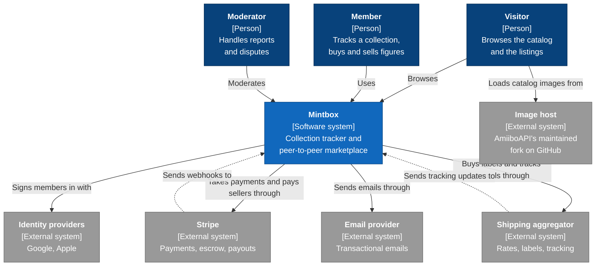
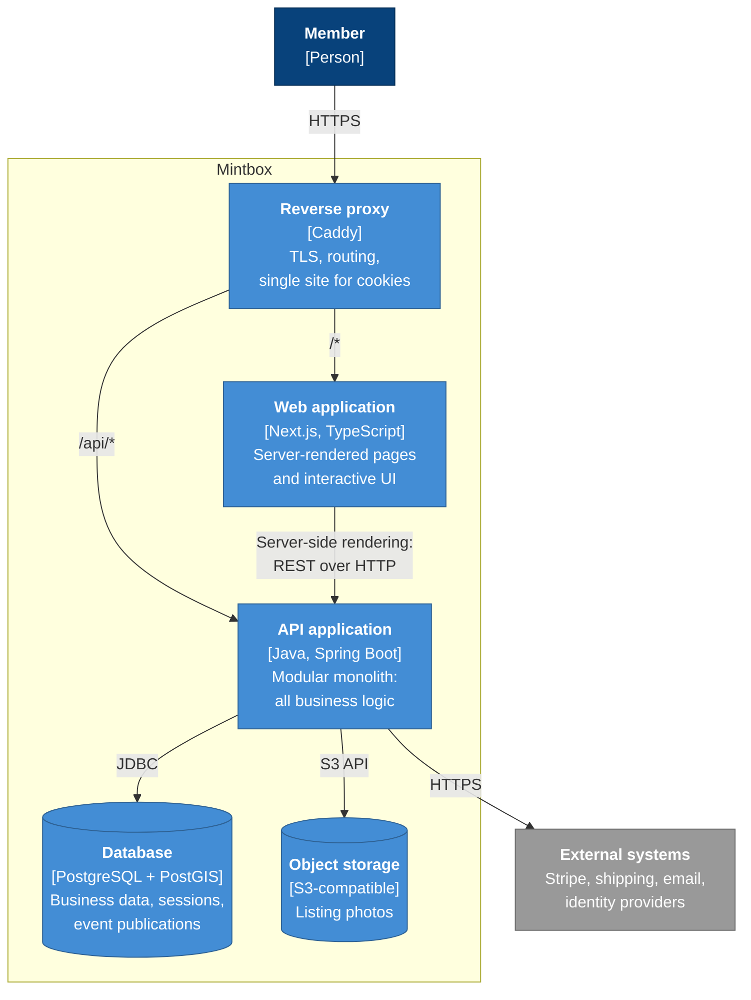

# Architecture

This page describes Mintbox with the first two levels of the
[C4 model](https://c4model.com/): the system in its environment, then the containers it is
made of. The modules inside the backend are described in the
[domain model](../domain/modules.md).

The diagrams use Mermaid flowcharts styled after C4, because they render directly on GitHub
and are easier to maintain than Mermaid's experimental C4 syntax.

## Level 1: system context

Who uses Mintbox, and which external systems it relies on.

- The catalog itself ships with the application as a versioned snapshot: Mintbox calls no
  external service to know which figures exist
  (see [ADR 0011](../adr/0011-amiibo-snapshot-as-source-of-truth.md)).
- Catalog images are loaded by the visitor's browser straight from their source: Mintbox
  doesn't host them (see [ADR 0007](../adr/0007-versioned-catalog-snapshot.md)).

## Level 2: containers

What runs, and how the pieces talk to each other.

- **The reverse proxy serves the web app and the API under the same site**, so the
  session cookie is first-party and no CORS is needed
  (see [ADR 0003](../adr/0003-server-side-sessions-over-jwt.md)).
- **The web app holds no business logic.** It renders pages and calls the API, either from
  the browser or from the server when it renders a page for search engines.
- **The API is the only container that talks to the database, the object storage and the
  external systems.**
- **The database also stores the sessions and the domain event publications**, so there is
  no extra container for them (see
  [ADR 0002](../adr/0002-modular-monolith-with-spring-modulith.md)).
- **Object storage** is described in
  [ADR 0008](../adr/0008-s3-compatible-object-storage.md).
- The choice of Caddy as reverse proxy will be confirmed when I set up the deployment.

## Local development

`compose.yaml`, at the root of the repository, starts the infrastructure the API needs:

| Service | Image | Port | Role |
|---------|-------|------|------|
| `postgres` | PostgreSQL 18 + PostGIS 3.6 | `5432` | Database |
| `storage` | SeaweedFS | `8333` | S3-compatible object storage |
| `mailpit` | Mailpit | `1025` (SMTP), `8025` (web UI) | Catches every email sent locally |

The API and the web app will be added to the same file once they exist, so that
`docker compose up` starts the whole stack.
