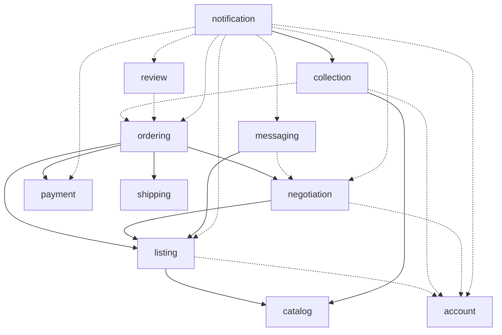

# Modules

Each module is a business area with its own data and rules (see
[ADR 0002](../adr/0002-modular-monolith-with-spring-modulith.md)). A module owns its
tables, and other modules only reach it through its public API or its events.

## Overview

| Module | Owns | Milestone |
|--------|------|-----------|
| `catalog` | Product lines, catalog entries, catalog synchronization | 1 |
| `account` | Members, credentials, sessions, public profiles | 2 |
| `collection` | Collection items, wishlist entries, series progress | 2 |
| `listing` | Listings, photos, listing search | 3 |
| `negotiation` | Negotiations and offers | 4 |
| `messaging` | Conversations between a buyer and a seller | 4 |
| `ordering` | Checkout, orders and their lifecycle | 5 |
| `payment` | Payments, refunds, payouts, payment provider webhooks | 5 |
| `shipping` | Shipping costs, labels, tracking | 5 |
| `review` | Reviews and reputation | 5 |
| `notification` | Emails and in-app notifications | 6 |

A `shared` module holds the few types every module needs: `Money` (see
[ADR 0005](../adr/0005-money-as-integer-minor-units.md)) and typed identifiers such as
`MemberId` or `CatalogEntryId`. I keep it deliberately small: it contains types, never
business logic.

## Dependencies

A solid arrow means "calls the public API of". A dashed arrow means "listens to the events
of". Both are dependencies, and both point in the same direction.

`shared` is left out of the diagram: every module depends on it.

## Why the arrows point this way

Spring Modulith rejects dependency cycles between modules, so every direction is a
decision. The rule I follow: **the module that drives a process calls the others; the
modules that only react listen to events.**

- **`ordering` drives the checkout.** It calls `listing` to reserve, sell or release a
  listing, and `payment` to take or refund money. `listing` and `payment` know nothing
  about orders. If `listing` listened to `OrderPaid` while `ordering` called `listing`,
  that would be a cycle.
- **`payment` reports back through events.** `ordering` listens to `PaymentSucceeded` and
  `PaymentFailed`. This is a dependency from `ordering` to `payment`, the same direction
  as the API calls.
- **`catalog` depends on nothing.** It is reference data, at the bottom of the graph.
- **`notification` sits at the top.** It only reacts, and nothing depends on it. It is the
  most natural module to extract into a separate service, if I ever need to.

## Data that crosses module boundaries

Since no module reads another module's tables, a module that needs another module's data
for its own queries keeps a **local copy**, updated through events.

The main case is search: `listing` needs the name, series and franchise of each catalog
entry to filter and rank listings. It keeps a snapshot of these fields in its listed items,
and refreshes them when `catalog` publishes `CatalogEntryUpdated`. Catalog entries rarely
change, so the copy is cheap to maintain, and search stays a single-table query.
