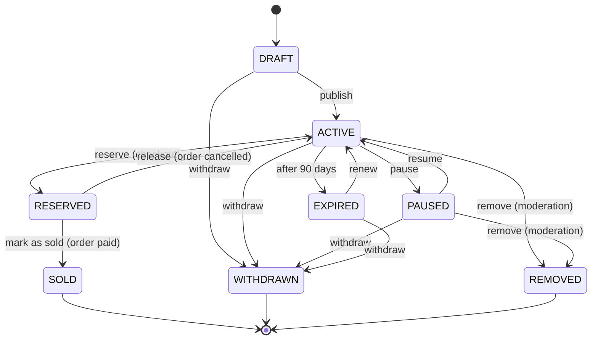
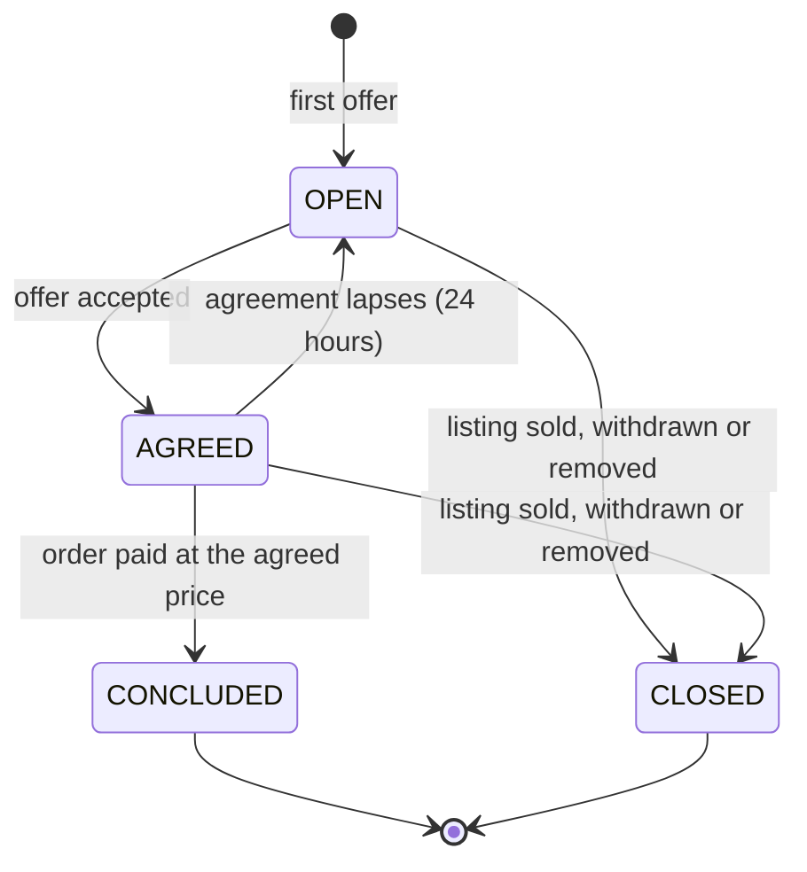
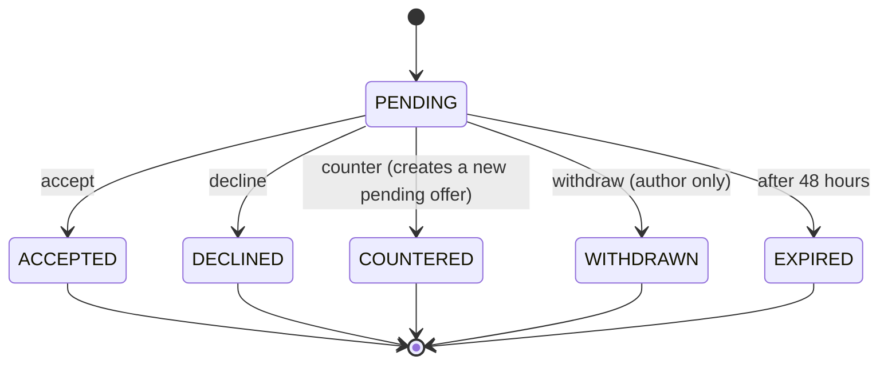
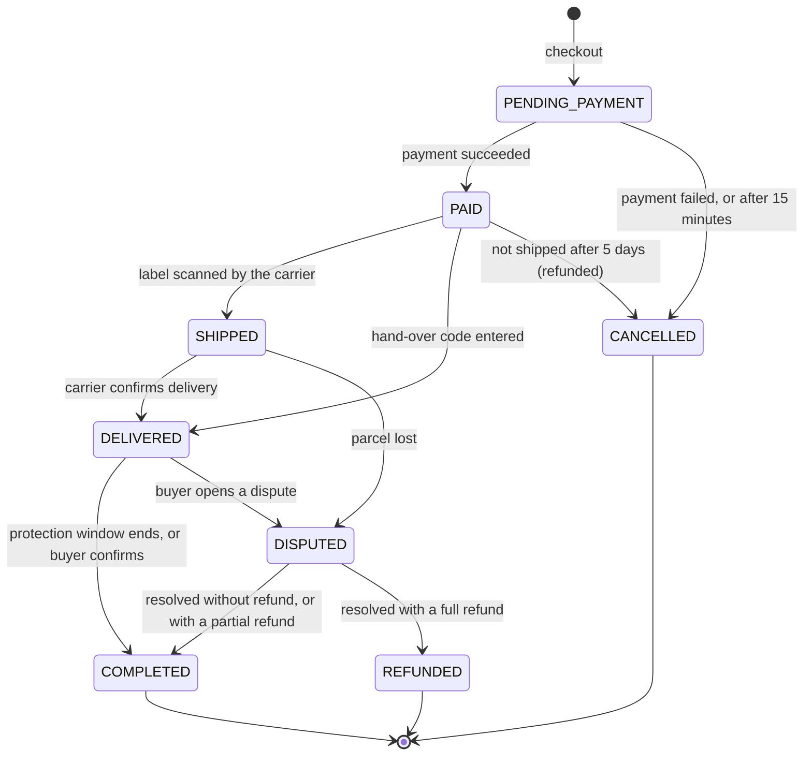

# State machines

Each diagram shows every allowed transition. Any transition that isn't drawn is refused by
the aggregate. Transitions triggered by time (expirations, timeouts) are run by scheduled
jobs, and their durations are configurable.

## Listing

- A **reserved** listing can't be paused, withdrawn or removed: an order is in progress,
  and the order decides what happens next.
- The original plan named the seller's removal `CANCELLED`. I renamed it **`WITHDRAWN`**,
  so that "cancelled" only means one thing in the whole domain: a cancelled order.
- **`REMOVED`** is reserved for moderation, so that a seller's own decision and a sanction
  stay distinguishable in the history and the statistics.

## Negotiation

A negotiation has its own lifecycle, and each offer inside it has another one.

- After an offer is declined, withdrawn or expired, the negotiation stays **open**: the
  buyer can make a new offer, within the limit of 5 offers.
- When a negotiation is closed, its pending offer, if any, expires with it.

## Order

- **Side effects of each transition**, carried out by `ordering` through the other modules'
  APIs:

  | Transition | Effect |
  |------------|--------|
  | → `PENDING_PAYMENT` | The listing is reserved, a payment is created. |
  | → `PAID` | The listing is marked as sold, the negotiation (if any) is concluded. |
  | `PENDING_PAYMENT` → `CANCELLED` | The listing is released. |
  | `PAID` → `CANCELLED` | The buyer is fully refunded. The listing stays sold: the seller has to relist it. |
  | → `COMPLETED` | The payout to the seller is released, minus any partial refund. |
  | → `REFUNDED` | The buyer is fully refunded, no payout. |

- A partial refund doesn't need its own state: the order is completed, and the refund is
  recorded on it.
- A dispute is resolved by a moderator. Until the moderation module exists, disputes are
  resolved through an internal endpoint.
